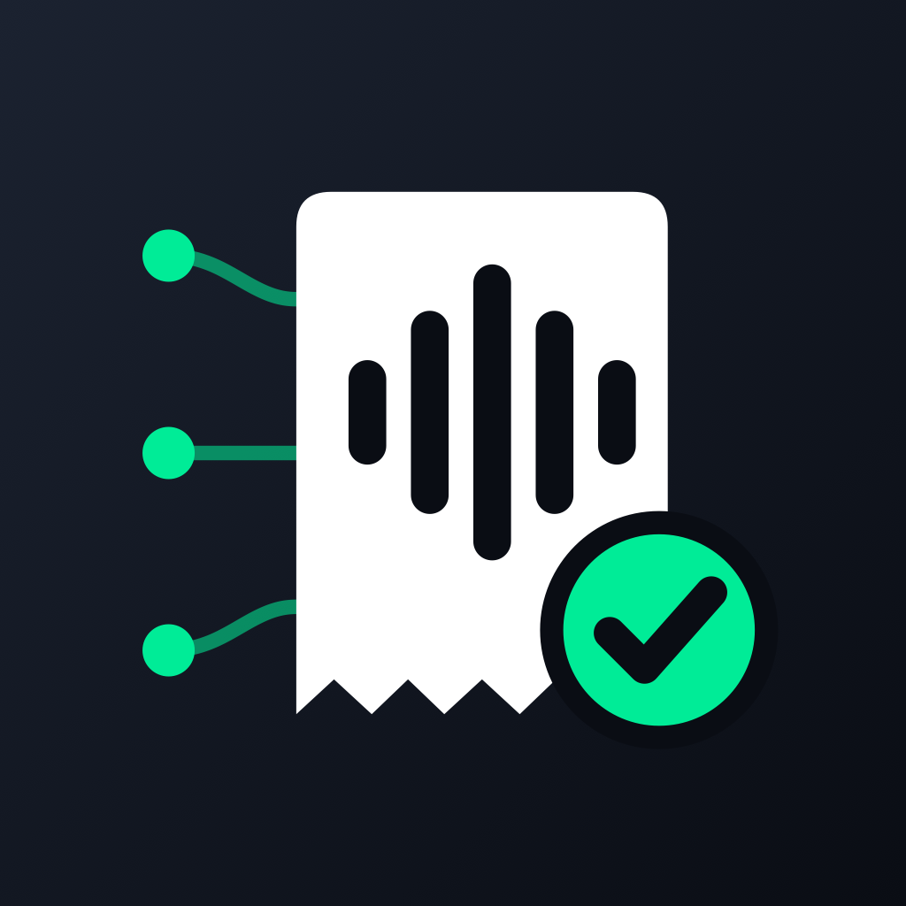

<p align="center"></p>

# Cobra on NEAR 🧾🎙️ · say who to bill, get paid in USDC on NEAR

**Track:** Real-World Money (also fits Agent Economy) · NEAR Hackathon, November 2026

Cobra is a Telegram assistant that bills your clients and chases payments for you. You send it a voice note:

> “Bill Marta Garcia 350 euros for the logo design, due in 15 days.”

Cobra transcribes it, understands who, how much, what for and when, and shows you the invoice. Tap **✅ Create payment link** and you get a link to forward to your client. **Your client pays with whatever they hold** (USDC or USDT on NEAR, Base, Arbitrum, Solana, Ethereum, Tron, BNB Chain, or BTC, ETH, SOL, NEAR, ZEC, BCH, LTC, DOGE, XRP, TRX). **You always receive USDC in your NEAR account**, settled through **NEAR Intents** (1Click API). Then Cobra keeps working:

- 💸 **Instant alerts**: “⏳ Marta is paying: 392.39 USDT · Tron detected, converting…”, then “💸 Marta paid you 350 €”, with a link to the NEAR transaction.
- 🔔 **Who owes me**: unpaid and overdue invoices at a glance. The AI writes a polite reminder; one tap forwards it with the payment link.
- ⏰ **Overdue alerts**: one warning per invoice, never spam.
- 📱 **Get paid in person**: open the payment page and let the client scan the QR.
- 📊 **Dashboard inside Telegram** (Mini App) and a CSV for your accountant.
- 🌐 English and Spanish. Invoices in EUR or USD, converted at the live rate.

**Cobra never holds funds or keys.** The client sends to a 1Click deposit address; NEAR Intents delivers exactly the invoiced USDC to the freelancer's NEAR account and refunds any excess or failed payment to the address the client gave.

### Get paid where you want

The freelancer picks the network once (⚙️ Settings → Where I get paid):

| Payout | How the client pays | Settlement |
|---|---|---|
| **USDC · NEAR** (default) | any token, any chain | NEAR Intents 1Click, `EXACT_OUTPUT` |
| **USDC · Arbitrum** | any token, any chain | NEAR Intents 1Click, `EXACT_OUTPUT` |
| **BCH · Bitcoin Cash** | any token, any chain | NEAR Intents 1Click, BCH at the live price |
| **MUSD · Mezo** | MUSD on Mezo, straight to the freelancer | Cobra watches MUSD `Transfer` logs for the exact amount |
| **CCD · Concordium** | CCD by a person, or by an AI agent over **x402** | Cobra watches the account, or verifies the agent's tx hash |
| **sats · Lightning** | any Lightning wallet, or a pasted **Cashu ecash** token | LNURL-pay invoice from the freelancer's Lightning address; ecash melted at its mint |

MUSD (Mezo's Bitcoin-backed stablecoin) is not routed by 1Click, so Mezo invoices are paid directly: the payment page shows the freelancer's address, the exact amount (tagged with the invoice id in the last wei so two equal invoices never collide), an EIP-681 QR, and a **Pay with my wallet** button that switches the wallet to Mezo and sends `transfer(to, amount)`. Cobra scans MUSD `Transfer` events to the freelancer every minute and alerts them with the explorer link. `MEZO_NETWORK` selects `testnet` (default, free to demo with faucet funds) or `mainnet`.

### Cashu ecash: pay an invoice by pasting a token

Built for Nut November (`src/cashu.js`, `src/lightning.js`). The freelancer gives a Lightning address (a Cashu wallet such as Minibits or npub.cash provides one, no KYC). For each payment attempt Cobra asks that address for a BOLT11 invoice of the exact amount in sats (LNURL-pay, LUD-06/16) and checks it is for the amount asked. The client can pay it from any Lightning wallet, or **paste a Cashu token**: Cobra melts it at the token's own mint straight into the freelancer's invoice (NUT-05 via `@cashu/cashu-ts`), so the ecash never rests with Cobra, and hands back any change as a fresh token. If anything fails, every proof goes back to the client as a token. Settlement is confirmed by the melt itself or, for plain Lightning, by the address's LUD-21 verify URL when it offers one.

### Concordium: accountable agents that get paid by other agents

Built for the Concordium Trusted Agents Hackathon (`src/concordium.js`, `handleX402` in `src/worker.js`, `scripts/x402-agent.mjs`):

- **x402 invoices.** `GET /x402/<invoice>` answers `402 Payment Required` with x402 payment requirements (`scheme: exact`, `network: concordium:testnet`, `asset: CCD`, `payTo` = the freelancer's Concordium account, `maxAmountRequired` = the invoice in microCCD, tagged with the invoice id). A buyer's agent sends the CCD transfer and repeats the request with `X-PAYMENT` (base64 JSON with `payload.txHash`). Cobra checks on chain that it is finalized, successful, to the right account and for the exact amount, never accepts a hash twice, settles the invoice, alerts the freelancer and returns `X-PAYMENT-RESPONSE`. `scripts/x402-agent.mjs` is a complete paying agent built on `@concordium/web-sdk`.
- **People pay too.** The payment page shows the account and exact CCD amount; Cobra watches the account through the wallet-proxy and settles automatically, or instantly when the client pastes the transaction hash (the page uses the same x402 endpoint).
- **Verified by Concordium.** Cobra is registered in the CIS-8004 Agent Registry. Its Agent Card (ERC-8004 + A2A, with the badge extension) is served byte for byte at `/.well-known/agent-card.json` so its SHA-256 matches the on-chain `metadata_hash`. Every payment page checks the badge live against the Agent Registry and shows **✓ Verified by Concordium**: the client knows an accountable, identity-verified human stands behind the invoice, which is exactly what invoice fraud lacks.

## Try it

- Bot: **[@Cobrainvoicebot](https://t.me/Cobrainvoicebot)** on Telegram (NEAR mainnet: payments are real, use a small amount).
- Send a voice note or text like “bill Marta 1 dollar for a test”, tap ✅, give your `.near` account, open the payment page, pick a token and chain, and pay.
- Open **📊 Invoices** in the chat for the dashboard.

## Why

Freelancers lose hours writing invoices and chasing payments, and international clients often can't pay them cheaply. Crypto fixes the rails but not the experience: the freelancer has to tell every client “send USDC on NEAR”, and the client has to own that exact token on that exact chain. With NEAR Intents the client pays with what they have, on the chain they use, and the freelancer gets one stable currency in one account. Cobra puts that behind a 10-second voice note in the chat app they already live in.

## How it works

```
Telegram ──webhook──▶ Cloudflare Worker (src/worker.js)
                        ├─ Workers AI · Whisper: voice → text
                        ├─ Workers AI · Llama 3.3 70B: text → intent + invoice JSON, corrections, reminder notes
                        ├─ D1 (SQLite): users, client book, drafts, invoices, deposits
                        ├─ NEAR RPC: checks the freelancer's NEAR account exists
                        └─ NEAR Intents 1Click (src/intents.js)
                             GET  /v0/tokens   live token list + EURe price for EUR invoices
                             POST /v0/quote    EXACT_OUTPUT → USDC on NEAR, recipient = freelancer
                             GET  /v0/status   KNOWN_DEPOSIT_TX → PROCESSING → SUCCESS / REFUNDED

Client ──▶ /pay/<token>   payment page: pick token + chain, get deposit address + QR, live status
Cron (every minute) ──▶ follows live deposits, alerts the freelancer, overdue warnings
```

Design details:

- **Exact amounts**: quotes are `EXACT_OUTPUT`, so the freelancer receives exactly the invoice value in USDC; the client sees the exact amount to send in their token. EUR invoices use the live EURe/USD price from 1Click.
- **One deposit address per attempt**, reused while it is valid, capped per invoice, each with its signed quote stored for disputes.
- **Human in the loop**: the AI only prepares drafts and reminder texts. Nothing is created or sent without a tap.
- **Alerts exactly once**: every status change is stored; “paid”, “incoming” and “refunded” are each sent once, and a second payment for a paid invoice is reported, not lost.
- **Payment page safety**: random 128-bit link per invoice, no internal ids exposed, JSON embedded safely, `noindex`.
- **Free to run**: Cloudflare Workers + D1 + Workers AI free tiers, with a daily AI budget. 1Click works without an API key (a partner key lowers fees).

## Run it

```bash
npm test                                  # 27 tests, no network
wrangler d1 create cobra-near             # put the id in wrangler.toml
wrangler d1 migrations apply cobra-near --remote
wrangler secret put BOT_TOKEN             # from @BotFather
wrangler secret put WEBHOOK_SECRET        # any random string
# set PUBLIC_URL in wrangler.toml to the Worker URL, then:
wrangler deploy
open "https://<worker>/setup?secret=<WEBHOOK_SECRET>"
```

Optional: `ONECLICK_API_KEY` (partner key from partners.near-intents.org), `NEAR_RPC`, `QUOTE_MINUTES`.

## Origin

Cobra started in October 2026 as a PayPal invoicing bot (MIT). For this hackathon the payment layer was rebuilt on NEAR: NEAR Intents 1Click integration (`src/intents.js`), deposits and payment lifecycle (`src/payments.js`), the client payment page (`src/paypage.js`), the NEAR account flow, the schema and the tests. The voice and AI conversation layer is reused.

## License

MIT
